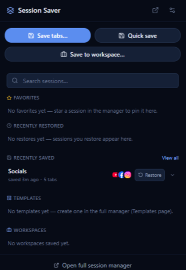
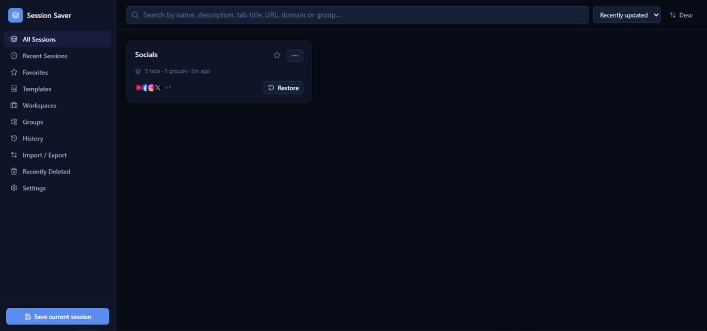
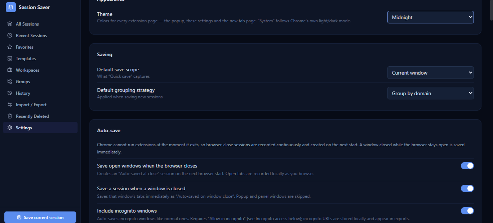
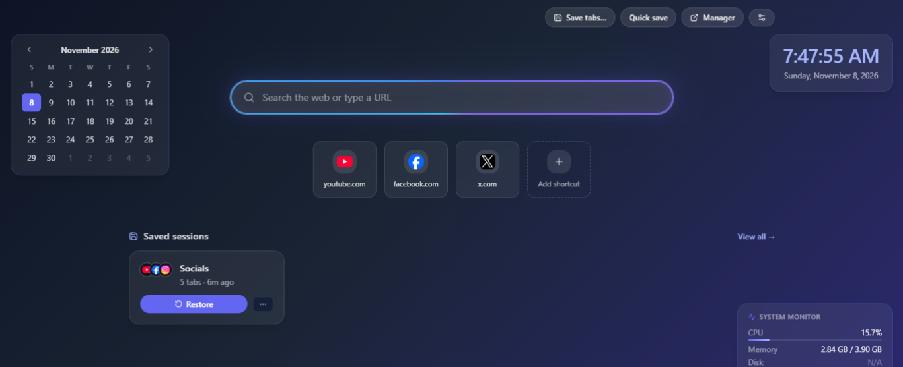

  
  <h1>Session Saver</h1>
  
<strong>Save your flow. Restore it whenever you need it.</strong>

  
Keep your tabs, windows, and browsing context organized — and pick up right where you left off.

  

    
    
    
    
  

---

## ✨ Your browsing, exactly where you left it

Save browser sessions, bring them back later, and keep related tabs together. Whether you are switching projects, researching, or closing a busy browser, your work is ready when you are.

## 📸 Screenshots

  
   
  <strong>Quick Access</strong> — favorites, recent sessions, and quick actions.

  
   
  <strong>Session Manager</strong> — browse and organize your saved sessions.

  
   
  <strong>Personalize your experience</strong> — adjust appearance, saving, and browsing preferences.

  
   
  <strong>A better new tab</strong> — shortcuts, sessions, and optional widgets at a glance.

## 🚀 Features

### Save & restore

- Save the current window, all open windows, or selected tabs.
- Preserve tab order, pinned tabs, active tabs, window layout, and supported Chrome tab groups.
- Preview a saved session and choose which tabs to reopen.
- Restore into the current window or a new window.
- Choose how duplicate tabs are handled.

### Stay organized

- **Favorites & Quick Access** — reach starred and recent sessions from the toolbar popup.
- **Groups** — organize related tabs by domain.
- **Templates** — keep reusable sets of websites for repeated tasks.
- **Workspaces** — collect tabs and windows for different projects.
- **Search & sorting** — find sessions by name, tab, URL, domain, or group.

### Keep your browsing history handy

- **Navigation history** — optionally record the pages visited in a tab.
- **Recently closed** — reopen closed tabs and windows from History.
- **Session versions** — revisit earlier saved states when available.

### Make it yours

- **New-tab homepage** — use an optional homepage with search and editable shortcuts.
- **Personalized layout** — show favorites, recent sessions, saved sessions, templates, and workspaces.
- **Widgets** — add optional clock, calendar, and system monitor widgets.
- **Themes & backgrounds** — customize the look of the interface.

### Recovery & backup

- **Automatic saving** — enable recovery when the browser or a window closes.
- **Recently Deleted** — recover removed items.
- **Import & export** — move sessions using JSON and HTML formats.
- **Backups** — create and restore portable backups of your Session Saver data.

## ⚡ Install in Chrome

The GitHub project includes the **ready-to-load extension folder**. No Node.js, npm, or build step is required.

1. Download the project using **Code → Download ZIP**, then extract the archive. (A release ZIP containing the same folders works too.)
2. Open **[chrome://extensions](chrome://extensions)** in Google Chrome.
3. Turn on **Developer mode**.
4. Click **Load unpacked**.
5. Select the **`Session Saver`** folder — it must be the folder that directly contains `manifest.json`.
6. Pin Session Saver from Chrome's Extensions menu for quick access.

> **Important:** Select `Session Saver/`, not the repository's top-level folder and not `assets/` or `screenshots/`.

## 🔒 Your data, your browser

Session Saver stores its data in your local Chrome profile. The supplied project does not include an account or cloud-sync service. Exported backups may contain saved URLs and browsing details, so keep them somewhere private.

## 📄 License

Released under the [MIT License](LICENSE).
